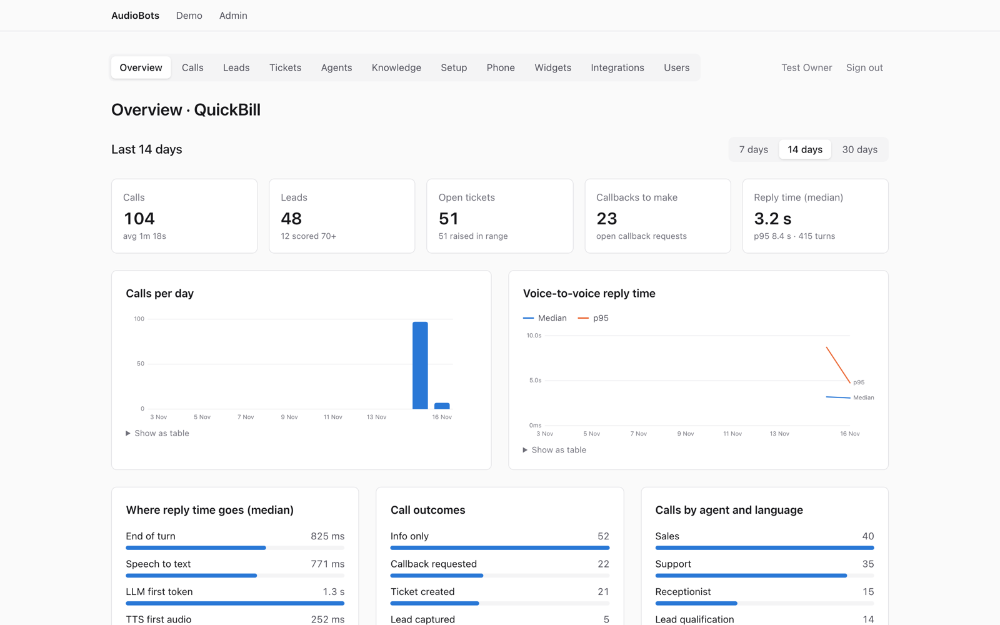
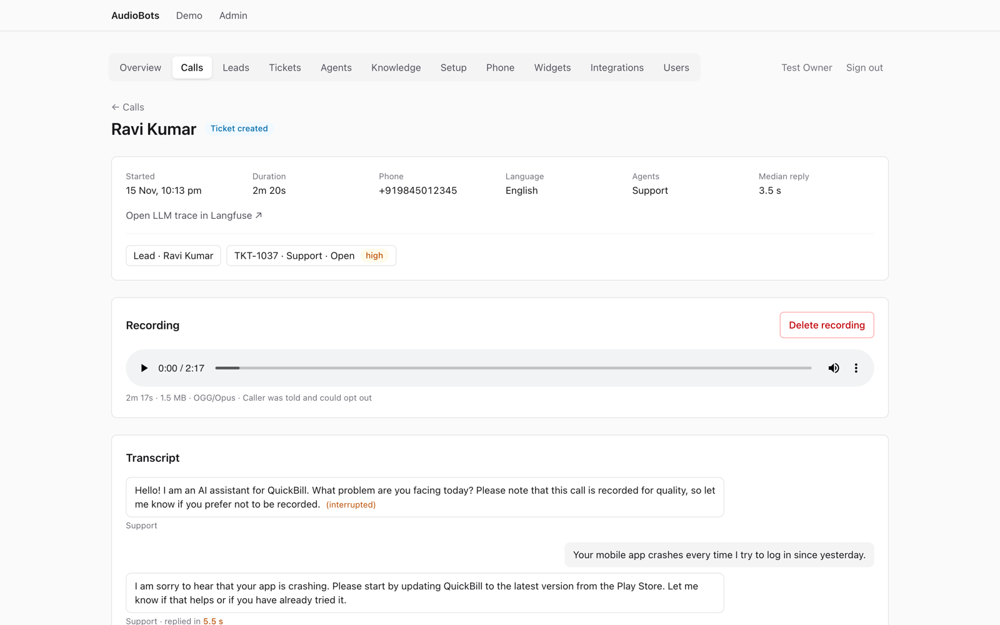
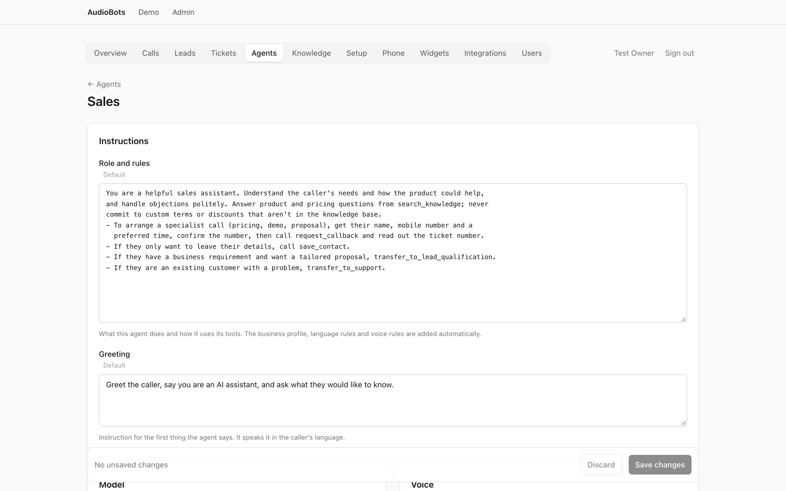
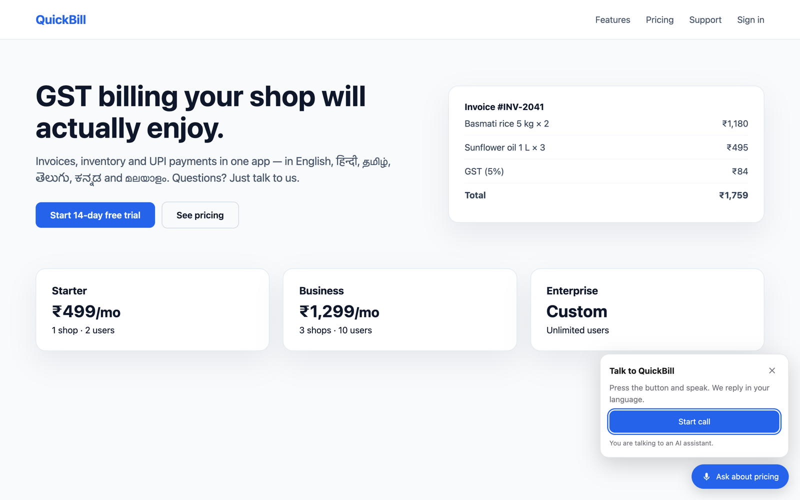
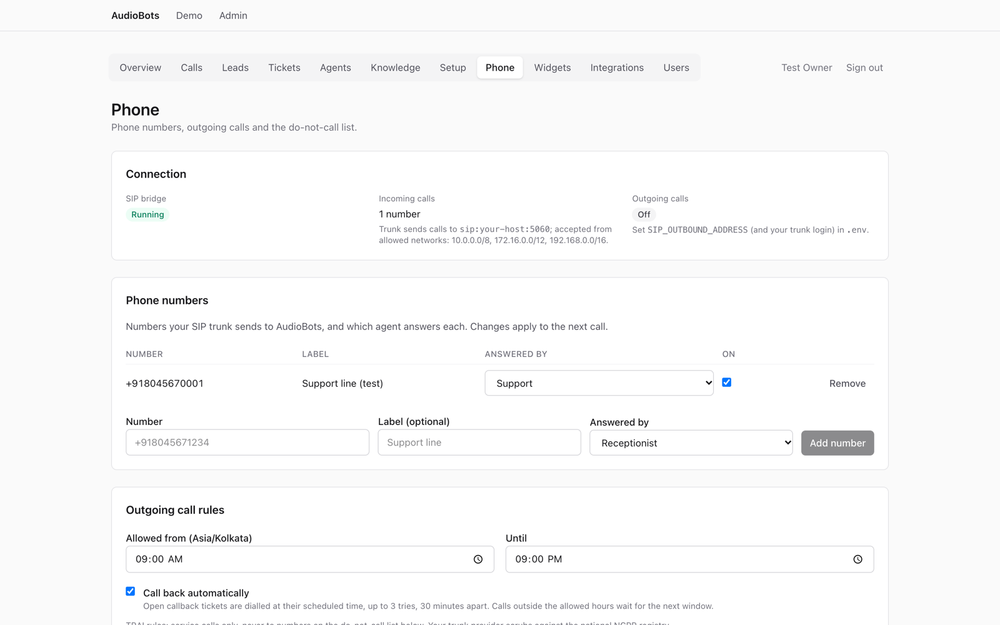
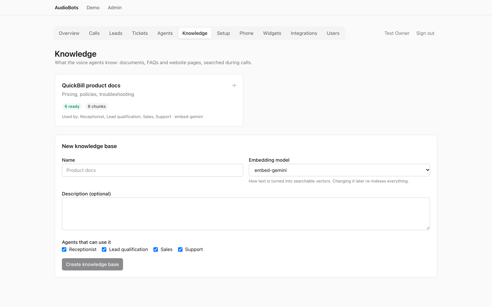
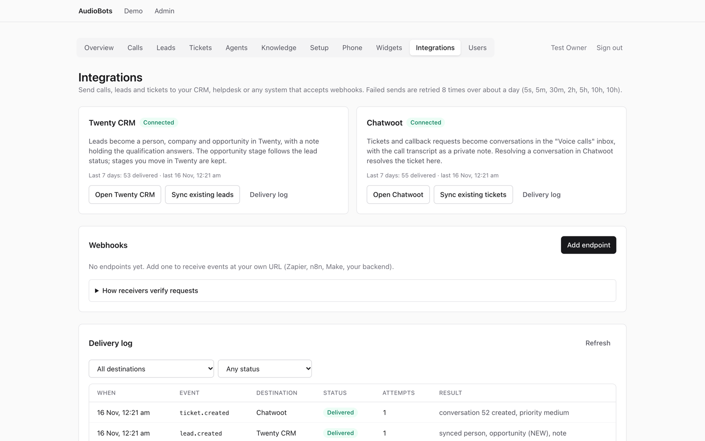
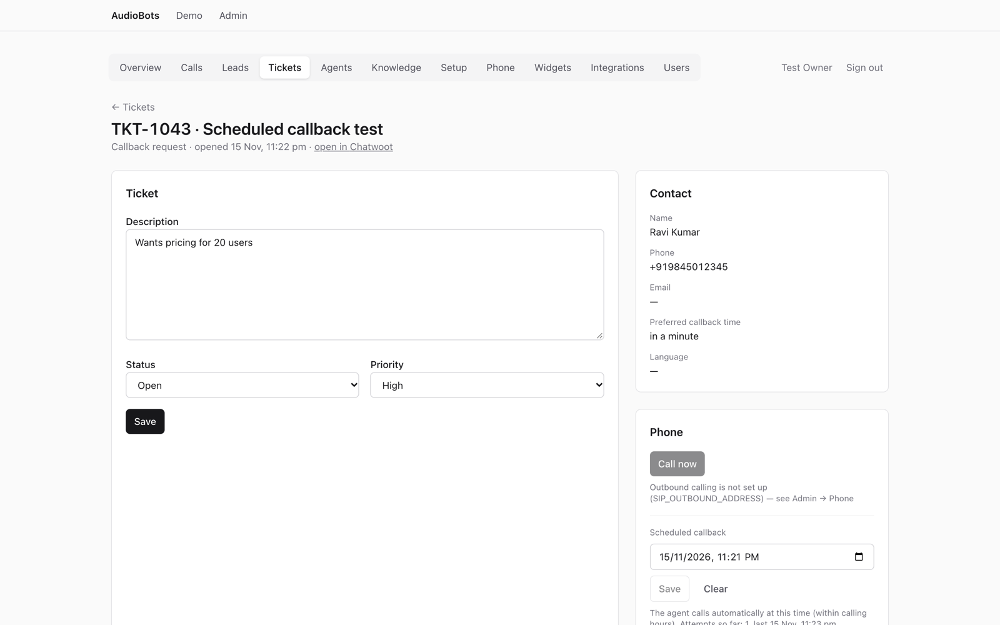
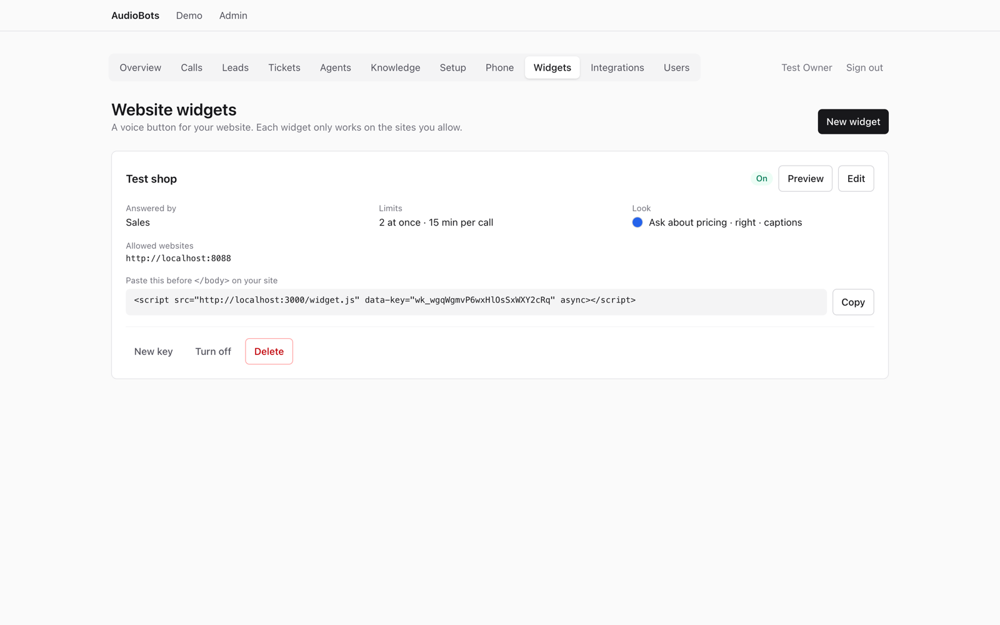

<div align="center">

# AudioBots

**Voice agents for Indian businesses: they answer the phone and your website, in six Indian languages.**

Sales, support and lead qualification over WebRTC and SIP, with a full admin dashboard, CRM sync,
call recording and analytics. Self-hosted on Docker; speech and LLMs are cloud APIs (no GPU needed).


English · हिन्दी / Hinglish · தமிழ் · తెలుగు · ಕನ್ನಡ · മലയാളം



</div>

## What it does

- **Talks like a person.** Streaming speech-to-text, LLM and text-to-speech with barge-in; about **3 s median voice-to-voice**, every stage timed on every turn. The language is detected per sentence, and the reply and voice switch with it.
- **Does real work.** A receptionist hands callers to *sales*, *support* or *lead qualification*. They capture leads with a score, raise tickets, book callbacks at the time the caller asked for, and answer only from your knowledge base.
- **Answers the phone.** Numbers ring the agent you choose; agents call customers back on schedule (within calling hours, never to the do-not-call list) and can hand a caller to a person.
- **Lives on your website.** One `<script>` tag adds a voice button with live captions, locked to your domains, with rate limits and call caps.
- **Fits your stack.** Leads land in **Twenty CRM**, tickets in **Chatwoot** (status syncs both ways), and any system can get **signed webhooks** with retries.
- **Is accountable.** Calls are recorded with consent (set per agent), played back next to the transcript, traced in **Langfuse**, and deleted on your retention schedule.

## A look around

<table>
  <tr>
    <td width="50%"><br><b>Every call</b>: recording, transcript, latency per turn, linked lead and ticket, LLM trace.</td>
    <td width="50%"><br><b>Agents without redeploys</b>: instructions, model, voice, turn timing, recording consent, transfer number.</td>
  </tr>
  <tr>
    <td><br><b>Website widget</b>: a voice button on any allowed site, in a Shadow DOM so the site's CSS can't break it.</td>
    <td><br><b>Phone</b>: numbers per agent, calling hours, automatic callbacks, do-not-call list.</td>
  </tr>
  <tr>
    <td><br><b>Knowledge</b>: documents, FAQs and web pages; embeddings provider chosen per knowledge base.</td>
    <td><br><b>Integrations</b>: Twenty and Chatwoot status, webhook endpoints, delivery log with retries.</td>
  </tr>
  <tr>
    <td><br><b>Callbacks</b>: <i>Call now</i> or a scheduled time; the agent opens with why it's calling.</td>
    <td><br><b>Widgets</b>: allowed websites, colours, captions, limits and a copy-paste snippet.</td>
  </tr>
</table>

## Quick start

You need Docker Desktop, a [Sarvam AI](https://www.sarvam.ai) key and a Gemini key (billing enabled; the free tier allows only 20 requests a day).

```bash
git clone https://github.com/shyam-achuthan/audiobot-starter-kit.git audiobots
cd audiobots
./setup.sh
```

`setup.sh` checks prerequisites, creates `.env` with generated secrets, asks for your keys, builds, starts and verifies everything, and offers to create the owner account. Then:

| Open | For |
|---|---|
| http://localhost:3000/demo | Talk to the agents in the browser |
| http://localhost:3000/admin | The dashboard (start with **Setup**: describe your business and add knowledge) |
| [docs/guide.html](docs/guide.html) | The full guide: architecture, configuration, latency, troubleshooting |

A sample knowledge pack for a fictional product (QuickBill) is in [samples/knowledge](samples/knowledge).

### Optional parts

Each is a Docker Compose profile, so the core stays light:

| Command | Adds |
|---|---|
| `make up-sip` | **Phone calls** through the LiveKit SIP bridge. Add numbers under Admin → Phone and point your SIP trunk (Exotel, Plivo, Tata…) or a softphone at the address shown there. `make sip-test` runs a smoke test with a scripted test phone. |
| `make up-rec` | **Call recording** (LiveKit Egress → RustFS, OGG/Opus), with consent per agent and retention in Admin → Setup |
| `make up-obs` | **Langfuse** at localhost:3040: every LLM request, grouped per call |
| `make up-crm` then `make crm-setup` | Local **Twenty CRM** and **Chatwoot**, connected automatically (Twenty needs one API key pasted) |

## Architecture


- **Agent** (`agent/`, LiveKit Agents, Python): the conversation, tools and handoffs.
- **API** (`api/`, NestJS + Sequelize): the system of record, auth, recordings, telephony, widgets and the webhook outbox.
- **Web** (`web/`, Next.js + Tailwind): the dashboard, demo page and the embeddable `widget.js` (Vite).
- **Every model sits behind an alias** (`agent-fast`, `embed-gemini`) in [`infra/litellm/config.yaml`](infra/litellm/config.yaml), so switching providers is a config change.

Decisions, phases and trade-offs are in [PLAN.md](PLAN.md).

## Status

Phases 0–8 are done and tested with scripted calls (web and SIP):

| | |
|---|---|
| ✅ Voice loop, six languages, latency telemetry | ✅ Workflows: receptionist, sales, support, lead qualification |
| ✅ Knowledge base (RAG) with per-KB embeddings | ✅ Admin dashboard, users and roles, per-agent settings |
| ✅ Webhooks, Twenty CRM, Chatwoot | ✅ Recording with consent, retention, Langfuse |
| ✅ Phone: inbound, outbound, scheduled callbacks, transfer | ✅ Website widget with allowed origins and limits |

Before going live: pick a SIP trunk provider, a domain with TLS, and keep the API port private (visitors reach it through the web app). Models stay cloud-hosted by design.

## Handy commands

```bash
make help                               # every target
make logs s=agent                       # follow one service
make ip                                 # after changing Wi-Fi (LiveKit advertises your LAN IP)
make admin-password email=you@example.com
make down                               # stop (keeps data); make clean also deletes data
```

## Repository layout

```
agent/    Python LiveKit Agents worker (conversation, tools, phone, scenario tests)
api/      NestJS API (business logic, recordings, telephony, widgets, webhooks, CRM sync)
web/      Next.js dashboard, demo page and widget.js
infra/    LiveKit, LiteLLM, Postgres config; scripted SIP test phone
scripts/  setup, env, CRM and SIP helpers
samples/  sample knowledge pack (fictional QuickBill product)
docs/     guide.html and screenshots
```
